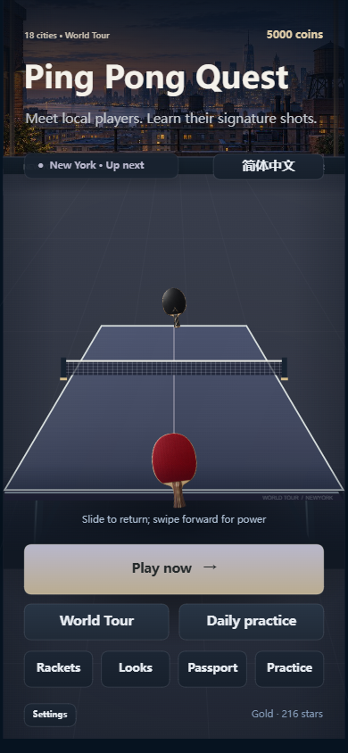

# 乒乓闯关王 · Ping Pong Quest

**中文** | [English](README.en.md)

一根手指控制球拍，挑战18座城市的球友。用长短球和变线拉开对手，抓住高球扣杀；赢下城市决赛后，学到对手的招牌球技。

现在是可运行的浏览器游戏，使用TypeScript、Canvas 2D和Vite。没有账号登录、广告、支付或抖音接入。



## 直接玩

用浏览器打开离线发行包里的 `pingpong-quest.html` 即可。图片和代码都在这个文件里，不需要Node.js、开发者工具或网络。桌面移动鼠标；手机用一根手指滑动。推荐竖屏。

构建命令会生成离线文件。浏览器允许本地存储时保存进度；隐私模式或禁用存储时，只能保留本次会话进度。文件版和网页部署版不自动同步存档。

## 从源码运行

安装Node.js 24 LTS（最低22.12），然后：

```sh
git clone https://github.com/13125846766/pingpong-quest.git
cd pingpong-quest
npm ci
npm run dev
```

打开终端显示的本地网址，默认 `http://localhost:5173/`。端口占用时Vite会显示实际端口。不要直接打开源码index.html。

```sh
npm run check      # 类型、测试、内容校验、网页和离线构建
npm start          # 需要时构建，再启动本地服务器
npm run build      # dist/web + dist/offline/pingpong-quest.html
```

Windows也可双击start-game.cmd。源码版安装依赖并启动服务器；发行包里存在离线HTML时，直接打开该文件。

## 中英文切换

首页、设置、比赛暂停页都可以切换简体中文和English。首次按浏览器语言选择，之后记住手动选择。菜单、城市、球友、关卡、球技、装备、奖励和比赛提示均已翻译。切换不修改比分、计时或进度。

## 游戏内容

- 18城108关，54名电脑对手。
- 每站：热身、风格对抗、特殊规则、强敌、30秒练招、城市决赛。
- 停拍接球、前挥加力、斜挥变线、收拍放短；球台和镜头固定。
- 两次本站球技选择，重试保留；击败冠军永久学习招牌动作。
- 4种球拍，各5级，23种外观，免费训练和每日练球。

前三城优先打磨。后15站已可进入，部分首领共用行为类型，难度仍需要真人试玩调整。

## 部署和贡献

dist/web可部署到静态网站，资源路径支持GitHub Pages仓库子目录。持续检查和手动Pages部署流程已经准备，见 [运行与部署](docs/RUNNING.md)。

贡献前运行npm run check。操作问题请附设备、浏览器、关卡和复现步骤。翻译位于src/i18n的两个JSON文件，保持键和参数一致。

[玩法](docs/GAME_DESIGN.md) · [语言](docs/LOCALIZATION.md) · [测试](docs/TEST_REPORT.md) · [路线](ROADMAP.md)

## 许可和来源

沿用仓库 [MIT许可证](LICENSE)。开发使用AI辅助；城市插画、等级球拍和图标由imagegen生成。击球与落台使用CC0实录，背景乐和其他音效由代码生成，见 [声音说明](docs/AUDIO.md) 和 [第三方说明](THIRD_PARTY_NOTICES.md)。没有复制参考游戏代码或美术。
